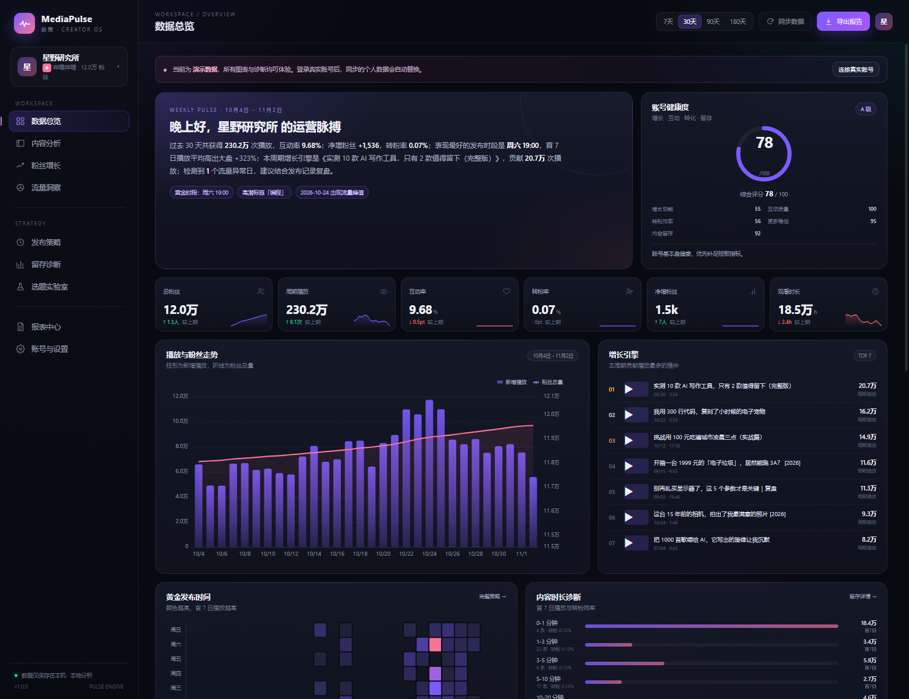

# MediaPulse · 脉策

> 自媒体数据驾驶舱：连接 B 站 / YouTube，自动同步播放、互动、粉丝、流量来源与留存，生成可视化图表、诊断建议和可归档报告。

MediaPulse 是一个 **Windows 桌面程序**，双击 `MediaPulse.exe` 即启动独立窗口。所有数据保存在本机，不需要部署服务器。



## 1. 快速开始

1. 双击 `MediaPulse.exe`。
2. 首次启动会自动生成一套**演示数据**（约 10-20 秒，取决于磁盘性能），所有页面都可以先体验。
3. 点击右上角/侧栏的「连接真实账号」，选择哔哩哔哩或 YouTube。
4. 登录成功后会自动同步一次；之后默认每 60 分钟检查一次（可在设置中关闭或调整），也可以随时点击「同步数据」。

> exe 未做商业代码签名，Windows SmartScreen 可能提示“已保护你的电脑”。点「更多信息 → 仍要运行」即可。源码与打包命令在下方，可自行重新构建。

## 2. 已实现的功能

### 数据接入
- **B 站**：App 扫码登录，不接触密码；读取公开稿件、播放/点赞/投币/收藏/评论/分享/弹幕，创作中心总览、近 30 天趋势、流量来源、受众画像。
- **YouTube**：Google OAuth 只读授权；Data API + YouTube Analytics API，读取频道、视频、每日播放/观看时长/涨粉、真实留存曲线、流量来源、年龄/性别/国家、搜索词。
- 多账号管理：同时保存多个 B 站 / YouTube 账号，随时切换。
- 本地 SQLite：账号、快照、每日指标、留存、评论、报告历史全部在本机。
- 后台增量同步 + 可配置自动同步间隔；任务进度实时显示。

### 可视化与诊断
- **数据总览**：粉丝/播放/互动/转粉/观看时长 KPI、粉丝曲线、增长引擎、健康度评分、转化漏斗、关键洞察。
- **内容分析**：全部稿件排序/筛选/搜索、时长 × 首 7 日播放散点、标题结构增益、标签表现、单稿详情抽屉。
- **粉丝增长**：粉丝累计、每日净增、14 天预测、里程碑进度、星期增长偏好、最会转粉的内容。
- **流量洞察**：来源占比、集中度 HHI、年龄/性别/设备/地区、YouTube 搜索词、流量风险诊断。
- **发布策略**：7×24 发布热力图、黄金时段与置信度、更新节奏/稳定性、时长效率、未来两周排期建议。
- **留存诊断**：3 秒留存/跳出、逐段留存曲线、留存 × 转粉散点、留存分档、单稿诊断清单。
- **选题实验室**：标题体检（预测首 7 日播放、结构优势、改写建议）、高潜标签、高杠杆时段、爆款基因、下一轮实验假设。
- **报表中心**：7/30/90 天报告，输出 **交互式 HTML + PDF + Excel**；CSV 快捷导出；历史报告归档。
- **可选 AI 摘要**：配置 DeepSeek API Key 后，生成报告时追加一段大模型运营结论；不配置也能使用全部规则诊断。

### 自动洞察（规则引擎，不依赖大模型）
- 最佳发布时间及置信度
- 不同时长的转粉率 / 3 秒跳出率
- 标题结构增益（数字、疑问、括号、教程、挑战、反常识）
- 内容标签集中度风险
- 更新节奏与断更风险
- 流量来源依赖风险
- 粉丝净流失预警
- 流量异常日（Z-score）
- 单稿优化建议（开场、收藏、冷启动、CTA 等）

## 3. 连接 B 站

1. 点击「连接账号 → 哔哩哔哩」。
2. 用哔哩哔哩 App 扫描二维码并在手机上确认。
3. 程序会用扫码得到的 Cookie 读取：
   - `api.bilibili.com` 公开视频信息
   - `member.bilibili.com/x/web/index/stat` 账号总览
   - `x/web/data/pandect` 近 30 天趋势
   - `x/web/data/playsource` 流量来源
   - `x/web/data/base` 受众画像
4. 若登录失效（Cookie 过期），设置页会显示「登录失效」，重新扫码即可。

**B 站口径说明（重要）**
- 平台不公开逐秒留存，也未提供单稿转粉接口。本程序中的 **B 站 3 秒留存、留存曲线、单稿转粉为互动模型估算**，用于账号内部相对比较，不等同于创作中心后台绝对值。
- 流量来源/受众画像来自创作中心，通常 T+1 更新。
- 同步频率过高可能触发风控，建议手动或 1 小时以上自动同步。

## 4. 连接 YouTube（需要自建 OAuth 客户端）

由于 YouTube Analytics 不允许公共应用直接读取任意账号，必须用你自己的 Google Cloud OAuth 客户端。全程只请求只读权限。

1. 打开 [Google Cloud Console](https://console.cloud.google.com/) 创建项目。
2. 在「API 和服务 → 库」启用：
   - **YouTube Data API v3**
   - **YouTube Analytics API**
3. 配置「OAuth 同意屏幕」：User Type 选 **External**，把你自己加入 **Test users**；应用不需要发布。
4. 「凭据 → 创建凭据 → OAuth 客户端 ID」：
   - 应用类型选择 **桌面应用**
   - 创建后下载 JSON
5. 回到 MediaPulse「连接账号 → YouTube」，把 JSON 内容粘贴进去，点击「开始 Google 授权」。
6. Google 授权窗口完成后回到程序，会自动创建账号并开始同步。

如果 Google 要求填写重定向 URI，程序弹窗里会显示当前端口，例如：

```
http://127.0.0.1:63598/oauth2callback
```

桌面应用类型通常允许 loopback 动态端口；如果使用「Web 应用」类型，需要把该 URI 精确加入已获授权的重定向 URI。

**YouTube 口径**
- 留存曲线、3 秒跳出、流量来源、搜索词、受众画像来自 YouTube Analytics，属于平台真实数据。
- 指标可能有 24–72 小时延迟；Quota 用尽时当天无法继续同步，次日恢复。

## 5. 数据与隐私

- 数据目录：`%APPDATA%\MediaPulse`（设置页会显示实际路径）。
  - `mediapulse.db`：SQLite 主库
  - `reports/`：HTML / PDF 报告
  - `exports/`：Excel / CSV
  - `mediapulse.log`：运行日志
- 登录 Cookie / OAuth Token 仅保存在本机 SQLite，不上传。
- 程序不会自动点赞、评论、投币、关注或发布内容，全部操作都是**只读采集**。
- 只有主动启用 AI 摘要并配置 Key 时，聚合指标才会发送给 DeepSeek；不发送评论原文、粉丝明细或登录凭据。
- 请仅分析你拥有或获得授权的账号，并遵守平台服务条款。

## 6. 报表说明

报表中心选择 7/30/90 天后会生成：

| 文件 | 内容 |
|---|---|
| `.html` | 自包含交互式报告（内嵌 ECharts），可离线打开、打印 |
| `.pdf` | 由 Edge/Chrome 无头模式渲染，适合归档/分享 |
| `.xlsx` | 6 个工作表：概览、每日数据、视频明细、发布时段、流量与受众、诊断建议 |

生成 PDF 需要本机安装 Microsoft Edge 或 Google Chrome；没有浏览器时会保留 HTML 并提示打印为 PDF。

## 7. 从源码运行 / 重新打包

环境：Windows 10/11，Python 3.11+（本项目在 Python 3.14 上构建）。

```powershell
cd mediapulse
python -m pip install pyinstaller pillow openpyxl
python -m app.main
```

浏览器打开终端输出的 `http://127.0.0.1:端口/?token=...`。开发模式不自动打开窗口；加 `--no-browser` 只启动服务。

重新打包：

```powershell
cd mediapulse
python -m PyInstaller --noconfirm --clean mediapulse.spec
# 产物：dist\MediaPulse.exe
```

构建依赖：
- [ECharts 5.5.1](https://echarts.apache.org/)（Apache-2.0）
- [qrcodejs](https://github.com/davidshimjs/qrcodejs)（MIT）
- openpyxl（MIT）
- PyInstaller（GPL with exception）

## 8. 目录结构

```
mediapulse/
├─ app/
│  ├─ main.py          # 启动、单实例、Edge App 窗口
│  ├─ server.py        # 本地 HTTP API / 静态资源 / OAuth 回调
│  ├─ store.py         # SQLite 表结构与持久化
│  ├─ demo.py          # 演示数据生成
│  ├─ analytics.py     # KPI、诊断、预测、标题模型
│  ├─ bilibili.py      # 扫码登录、WBI、创作中心同步
│  ├─ youtube.py       # OAuth、Data API、Analytics
│  ├─ reports.py       # HTML / PDF / Excel
│  ├─ llm.py           # 可选 DeepSeek 摘要
│  └─ config.py
├─ web/                # 前端 SPA（原生 JS + ECharts）
├─ assets/             # 图标
├─ docs/               # 截图
├─ dist/MediaPulse.exe # 打包产物
└─ mediapulse.spec
```

## 9. 常见问题

**Q：双击没反应？**
查看 `%APPDATA%\MediaPulse\mediapulse.log`；常见原因是端口被占用或安全软件拦截。关闭旧进程后重试。

**Q：B 站提示“登录失效”？**
Cookie 会过期，重新扫码即可。程序不会保存密码。

**Q：B 站数据为空或稿件不全？**
创作中心接口可能因风控、账号权限或接口变更返回空。先确认浏览器能打开创作中心；降低同步频率，隔一段时间重试。程序会保留已采集的历史数据。

**Q：YouTube 授权报 `redirect_uri_mismatch`？**
确认 OAuth 客户端类型是「桌面应用」；若是「Web 应用」，把弹窗显示的完整回调地址加入 Google Cloud 的重定向 URI。

**Q：3 秒跳出率为什么和 B 站后台不一样？**
B 站不公开逐秒留存，程序用的是互动/时长代理模型；请以相对趋势为准。YouTube 为平台真实留存。

**Q：换电脑怎么迁移？**
关闭程序后复制整个 `%APPDATA%\MediaPulse` 目录；Cookie/Token 也会一并迁移，注意不要分享给他人。

---

MediaPulse · 脉策 · v1.0.0 · 2026-11
