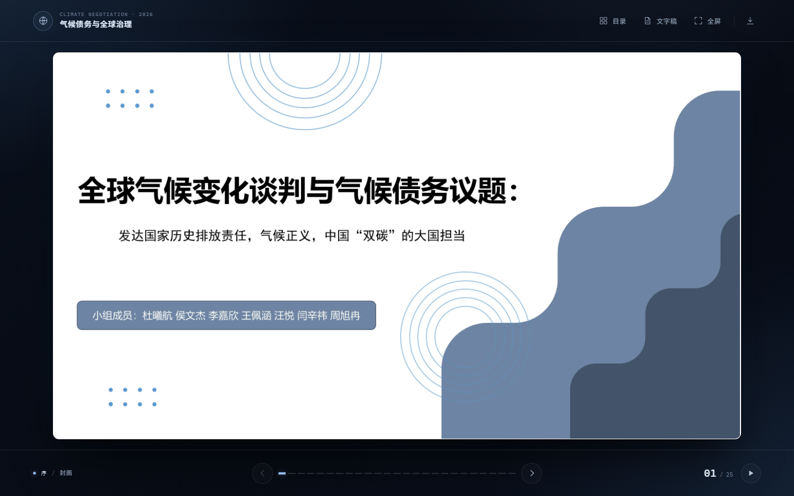

# 全球气候变化谈判与气候债务议题

课程小组汇报的静态交互网页版。25 页原版 PPT 按 1:1 版面还原，支持目录浏览、文字稿检索、自动播放、全屏放映、键盘与触屏操作，可直接部署到 GitHub Pages。

**在线演示：** <https://sdfz-obvious.github.io/climate-debt-deck/>



## 直接打开

- 在线访问上面的 GitHub Pages 地址。
- 本地预览：直接双击 `index.html` 即可（页面不依赖 `fetch`，`file://` 下也能运行）。
- 或者起一个静态服务器：

```bash
python -m http.server 8000
# 浏览器打开 http://localhost:8000/
```

## 操作方式

| 操作 | 功能 |
| --- | --- |
| `←` `→` / `↑` `↓` / `PageUp` `PageDown` / `空格` | 上一页 / 下一页 |
| 点击幻灯片、右侧箭头 | 下一页 |
| 点击左侧箭头、鼠标侧滑、手机左右滑动 | 上一页 / 下一页 |
| `Home` / `End` | 回到封面 / 最后一页 |
| `O` | 打开幻灯片目录 |
| `T` | 打开可检索文字稿 |
| `F` | 全屏放映 / 退出全屏 |
| `Esc` | 关闭面板或退出全屏 |
| `?` | 显示快捷键提示 |

底部进度条可直接点击跳页；右下角按钮可每 8 秒自动翻页。

## 保真说明

- 每一页都由本机 Microsoft PowerPoint 以 **2560 × 1440** 渲染导出，再转为 WebP（质量 92）。字体、图片、形状、图表、SmartArt、阴影和版式都保留在原始渲染中，不依赖访问者安装“思源黑体”等字体。
- 页面按 16:9 使用 `object-fit: contain` 等比呈现，不会拉伸、裁切或重排。
- 原 PPTX 经 PowerPoint 对象模型与 OOXML 双重检查：25 页均为 **0 个时间轴动画、0 个交互式动画、0 个幻灯片切换效果**。因此原稿没有可丢失的动画；网页的淡入淡出、自动播放属于浏览体验增强，不改变原版面。
- 幻灯片上的文字是像素级还原，不可在图上直接选中；完整文字已提取到“文字稿”面板，可搜索、复制，并提供每页跳转。
- 原稿保存在 [`download/xi-gai.pptx`](download/xi-gai.pptx)，可下载后继续编辑。

## 目录结构

```text
.
├── index.html                  # 唯一入口，GitHub Pages 直接访问
├── assets/
│   ├── css/style.css
│   ├── js/app.js
│   ├── slides/slide-01.webp …  # 25 张 2560×1440 正片
│   ├── thumbs/slide-01.webp …  # 25 张目录缩略图
│   ├── favicon.svg
│   ├── og-cover.jpg
│   └── screenshot-desktop.png
├── data/slides.js              # 标题、章节、文字稿
├── download/xi-gai.pptx        # 原始演示文稿
├── tools/                      # 重新导出与压缩脚本
├── .nojekyll
└── README.md
```

## 部署到 GitHub Pages

仓库已经按“根目录 `index.html`”组织，不需要构建步骤。

1. 把整个目录推到 GitHub 仓库的 `main` 分支根目录。
2. 打开仓库 **Settings → Pages**。
3. **Build and deployment** 选择 **Deploy from a branch**，分支选 `main`，目录选 `/ (root)`，保存。
4. 等待约 1 分钟，访问：

```text
https://<用户名>.github.io/<仓库名>/
```

如果使用命令行：

```bash
git init
git add .
git commit -m "Add interactive climate debt presentation"
git branch -M main
git remote add origin https://github.com/<用户名>/<仓库名>.git
git push -u origin main
```

## 重新生成页面素材

修改原 PPT 后，可在安装了桌面版 PowerPoint 的 Windows 上重新导出：

```powershell
# 1. 导出 25 张 2560×1440 PNG
pwsh -File tools/export_slides.ps1

# 2. 压缩为 WebP 正片与缩略图
python tools/build_assets.py
```

`tools/export_slides.ps1` 默认读取 `download/xi-gai.pptx`，输出到 `slides-export/`；`tools/build_assets.py` 读取该目录并覆盖 `assets/slides` 与 `assets/thumbs`。

## 说明

- 页面不加载任何外部 CDN、字体或统计脚本，断网也能播放。
- 建议使用较新的 Chrome、Edge、Safari 或 Firefox；全屏 API 不可用时会自动退化为沉浸模式。
- 课程内容版权归汇报小组所有；页面代码可自由用于同类展示场景。
